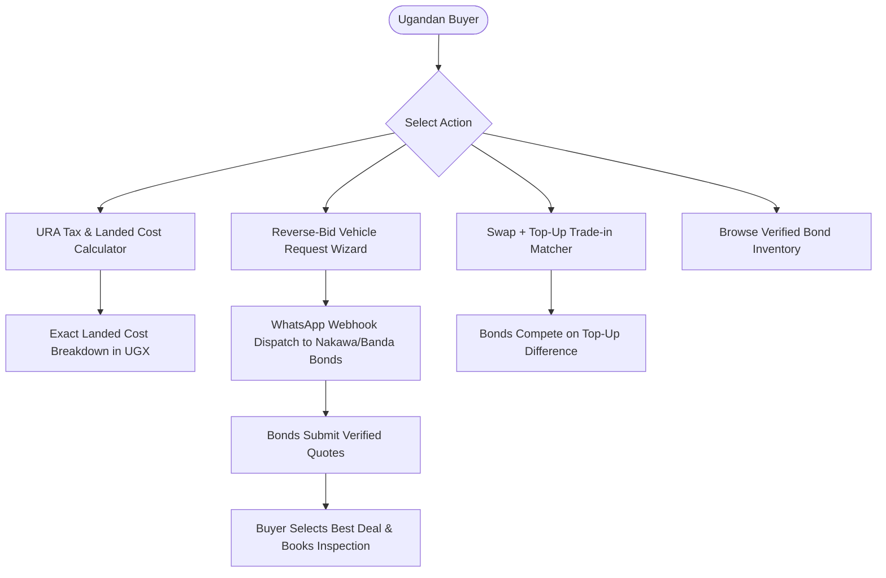

# klaautos.ug — Carwow-Style Reverse-Bidding & Verified Auto Marketplace for Uganda

* **Project:** klaautos.ug
* **Date:** 2026-10-27
* **Working Document:** [concepts_brief.md](file:///d:/kla%20autos/concepts_brief.md)

---

## 1. Executive Summary & Problem Framing

Carwow revolutionized vehicle buying in the UK by letting buyers configure brand-new factory vehicles and receive discounted quotes from franchised dealers. 

In Uganda, a 1:1 clone fails because 90%+ of the vehicle market consists of:
1. **Unregistered Japanese / Dubai imports** stored in bonded warehouses across Kampala (Nakawa, Banda, Kyambogo, Pine, Jinja Road).
2. **Direct CIF import orders** shipped via Mombasa port with heavy URA tax liabilities.
3. **Numbered local used cars** (e.g., UBH, UBJ, UBL, UBN, UBP series) subject to aggressive street-broker markups (*"bakayungirizi"*).

`klaautos.ug` adapts Carwow's core reverse-bidding engine for Uganda's exact market mechanics:
- **Transparent Landed Pricing:** Built-in URA customs tax & clearing calculator.
- **Direct Bond Reverse Bidding:** Verified car bonds submit competitive cash quotes on buyer requests.
- **Instant Swap & Top-Up Matching:** Structured valuation for trading in existing cars.
- **Anti-Broker Yard Verification:** Verified physical bond stock to eliminate phantom middleman markups.
- **Financing & Inspection Hub:** Bank loan installment calculators and Japan auction sheet / logbook verification.

---

## 2. Reverse Engineering Analysis (REA Findings)

Inspection of Carwow’s live application architecture reveals five primary subsystems that map directly into `klaautos.ug`:

| Carwow UK Subsystem | `klaautos.ug` Ugandan Adaptation |
| :--- | :--- |
| `controllers/buying/qualification_concierge` | **Buyer Request Wizard:** Multi-step wizard capturing target make/model, year, transmission, fuel, budget in UGX, and acquisition path (Bond Stock vs. Direct Import vs. Numbered Used). |
| `controllers/buying/offers_loading_controller` | **Reverse-Bid Lead Engine:** Pushes qualified requests to verified bond managers via WhatsApp API and dealer portal. |
| `controllers/buying/part_exchange_component` | **"Top-Up" Swap Matcher:** Buyer inputs current car details (e.g., 2007 Premio UBA) + desired upgrade; bonds bid the top-up difference. |
| `controllers/deals/range_calculator_controller` | **Asset Finance & Import Loan Calculator:** Integration with Ugandan banks (Stanbic, DFCU, Equity, NCBA) and clearing duty financiers. |
| `controllers/selling/appraisal/accident_history` | **Chassis & Logbook Verification:** Auction sheet cross-referencing and URA e-Tax logbook validation. |

---

## 3. High-Conversion Core Features

---

## 4. Proposed Implementation Plan

* **Milestone 1:** Next.js application scaffold with modern, high-contrast automotive UI.
* **Milestone 2:** Deterministic URA Customs Tax & Landed Cost calculation engine covering:
  * 25% Import Duty
  * 18% VAT
  * 6% Withholding Tax
  * 1.5% Infrastructure Levy
  * Age-tiered Environmental Levy (0% to 50%)
  * Registration plates & Mombasa port-to-Kampala transit fees
* **Milestone 3:** 4-step Reverse-Bidding Vehicle Request flow with buyer lead generation.
* **Milestone 4:** Swap + Top-Up Trade-In matching tool.
* **Milestone 5:** Verified Bond directory & stock showcase (Nakawa, Banda, Kyambogo).
* **Milestone 6:** WhatsApp alert dispatcher & dealer quotation simulator.
